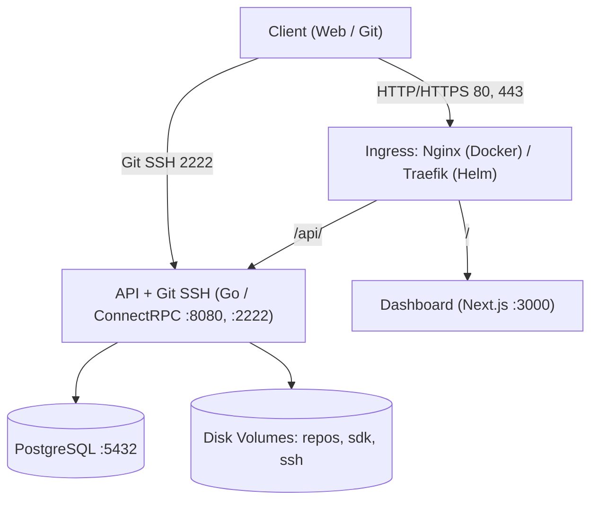

# Hasir

**Hasir** is a self-hosted [Protobuf](https://protobuf.dev) schema registry. Push `.proto` files over Git (SSH or HTTP) to generate commit-pinned client SDKs and API docs.

[](LICENSE)
[](https://github.com/lynicis/hasir/releases)
[](https://github.com/lynicis/hasir/commits/main)
[](https://github.com/lynicis/hasir/actions/workflows/codeql.yml)

## Why Hasir

- **vs. [Buf Schema Registry (BSR)](https://buf.build/product/bsr):** Self-hosting BSR requires its Enterprise tier, and paid hosted tiers bill per Protobuf type. Hasir is MIT-licensed, runs on your own VPS or Kubernetes cluster with PostgreSQL and local disk, and accepts plain `git push` over built-in SSH (`:2222`) or HTTP with no separate push CLI. Pick BSR instead if you need managed npm/PyPI/Maven/Cargo/Go registries, cross-repo module dependencies, server-side `buf breaking` / `buf lint` push gates, or SAML/OIDC SSO.
- **vs. Plain Git + CI (`protoc` / `buf generate`):** You stop maintaining codegen workflows, deploy keys, and publish scripts in every service repo. On push, a PostgreSQL worker pool runs enabled targets from 12 built-in generators (Go: Protobuf, gRPC, [ConnectRPC](https://connectrpc.com); JS/TS: `@bufbuild/es`, `protocolbuffers`, `@connectrpc`; Java, C#, and Rust: Protobuf and gRPC) and builds Markdown docs under `/docs/`. Stick with Git + CI if you rely on PR review gates on schemas, arbitrary custom `protoc` plugins, or publishing to an internal Artifactory/npm/Maven registry.
- **vs. [Apicurio](https://www.apicur.io/registry/) / [Confluent Schema Registry](https://docs.confluent.io/platform/current/schema-registry/index.html):** Those handle runtime serialization and wire-format schema IDs for Kafka and event streams across Avro, JSON Schema, and Protobuf. Hasir covers Protobuf RPC contracts and client SDK generation only.

**Skip Hasir if** you need non-Protobuf formats, Kafka schema IDs, push-time breaking-change rejection, or native package feeds (npm, PyPI, Maven) instead of Git-served SDK repos.

## Usage

Once Hasir is running (locally or on a server — see [Deploy](#deploy) or [Local Development](#monorepo--local-development)):

1. Sign in to the dashboard, add your SSH public key, and create a repository. Enable the built-in SDK targets you want, or turn on [Buf](https://buf.build) mode so Hasir detects matching built-in targets from your `buf.gen.yaml` (arbitrary custom plugins are not executed).
2. Test your SSH key against Hasir's SSH server:

```bash
ssh -T git@hasir.example.com -p 2222
# ✅ SSH connection successful!
# 🔐 Authentication completed.
```

3. Clone the repository by its dashboard ID and push `.proto` files (see [`packages/proto/proto/`](packages/proto/proto/) for working Protobuf services in this repo):

```bash
git clone ssh://git@hasir.example.com:2222/<repositoryId>.git
cd <repositoryId>
git add user/v1/user.proto
git commit -m "add user service"
git push origin main
```

Hasir queues generation jobs in PostgreSQL and serves read-only Git SDK repositories at `/sdk/<orgId>/<repositoryId>/<commitHash>/<sdkType>` (or without `<commitHash>` for the unpinned path) alongside Markdown docs under `/docs/`. Git over HTTP also works at `/git/<repositoryId>.git` using HTTP Basic Auth with a dashboard API key.

4. Install a generated SDK from the URL shown in the dashboard:

```bash
# TypeScript / JavaScript over Git-SSH
npm install git+ssh://git@hasir.example.com:2222/sdk/<orgId>/<repositoryId>/<commitHash>/js-connectrpc/

# Go via go-import (pointing at the API host, e.g. localhost:8080 or a dedicated API domain)
go env -w GOPRIVATE=api.hasir.example.com GONOSUMDB=api.hasir.example.com
go get api.hasir.example.com/sdk/<orgId>/<repositoryId>/<commitHash>/go-connectrpc
```

## Deploy

Hasir needs PostgreSQL 16+, persistent disk storage for Git repos, SDKs, and SSH host keys, and open ports `80`/`443` (HTTP/HTTPS) and `2222` (Git SSH). To evaluate on a laptop without a server, skip to [Local Development](#monorepo--local-development).

### Docker Compose (single Debian/Ubuntu VPS)

Requires `sudo`, a domain pointed at the server, and `apt-get`/`ufw`/`systemctl` (used by `setup.sh`):

```bash
git clone https://github.com/lynicis/hasir.git
cd hasir/deploy/docker

# Install Docker/UFW/Fail2Ban and create .env with generated DB and JWT secrets
sudo ./scripts/setup.sh

# Set DOMAIN, LETSENCRYPT_EMAIL, and SMTP_* values (keep the generated secrets)
$EDITOR .env

# Re-run setup so the bootstrap TLS certificate matches your DOMAIN
sudo ./scripts/setup.sh

# Pull published ghcr.io images, start services, and request a Let's Encrypt cert
sudo ./scripts/deploy.sh
```

Verify the stack:

```bash
docker compose ps
curl -fsS https://your-domain.com/health
# OK
```

See [`deploy/docker/README.md`](deploy/docker/README.md) and [`deploy/docker/.env.example`](deploy/docker/.env.example) for environment variables, daily PostgreSQL backups (`scripts/backup.sh`), restore steps, and troubleshooting.

### Kubernetes (Helm)

Requires Kubernetes 1.19+, Helm 3+, a StorageClass for `ReadWriteOnce` volumes, and an Ingress controller (chart defaults to `traefik` with `cert-manager`; SSH `:2222` uses a separate `LoadBalancer` Service):

```bash
git clone https://github.com/lynicis/hasir.git
cd hasir
helm repo add bitnami https://charts.bitnami.com/bitnami
helm dependency update deploy/helm/charts/hasir
cp deploy/helm/charts/hasir/values.yaml my-values.yaml
# Edit my-values.yaml to replace hasir.local and default JWT, PostgreSQL, and SMTP secrets
helm install hasir deploy/helm/charts/hasir -f my-values.yaml --namespace hasir --create-namespace
```

See [`deploy/helm/README.md`](deploy/helm/README.md) for all chart values and upgrade or uninstall commands.

> [!NOTE]
> The published `ghcr.io/lynicis/hasir-api` image ([`apps/api/Dockerfile`](apps/api/Dockerfile)) bundles `git` only. SDK and doc generation invokes `buf`, `protoc`, and language `protoc-gen-*` plugins from `PATH`, so containerized codegen needs a custom API image with your required compilers installed, or running the API on a host that already has them.

## Architecture

Nginx (Docker Compose) or Traefik (Helm) handles HTTPS on ports `80` and `443`. It routes `/` to the Next.js dashboard (`:3000`) and `/api/` to the Go [ConnectRPC](https://connectrpc.com) API (`:8080`). Git SSH (`:2222`) skips HTTP ingress and hits the API's embedded SSH server directly. The API enforces JWT auth and organization roles (`owner`, `author`, `reader`), stores metadata and job queues in PostgreSQL (`:5432`), and writes bare Git repos, generated SDKs, and SSH host keys to single-replica `ReadWriteOnce` volumes.



Read [`CONTEXT.md`](CONTEXT.md) for component internals, interceptor order, and release channels, or browse [`docs/adr/`](docs/adr/) for architecture decision records.

## Status, Security & Support

- **Status:** Active development, pre-stability 1.x (`hasir-api@1.3.0`, `hasir-dashboard@1.4.0`). You can self-host and evaluate it today, though APIs, config keys, and Helm defaults may still change between releases.
- **Releases:** Each app versions independently with Changesets on `main`. See [GitHub Releases](https://github.com/lynicis/hasir/releases) and [`docs/RELEASE.md`](docs/RELEASE.md) for changelogs and breaking notes.
- **Security:** Report vulnerabilities privately via [`SECURITY.md`](SECURITY.md) (48-hour acknowledgment, 5-business-day initial assessment). Secrets use [SOPS](https://getsops.io/), and CI runs CodeQL and `govulncheck`.
- **Support:** Solo-maintained on a best-effort basis through [GitHub Issues](https://github.com/lynicis/hasir/issues), with no commercial SLA.

## Monorepo & Local Development

| Workspace | Purpose |
| --- | --- |
| [`apps/api/`](apps/api/README.md) | Go 1.27 ConnectRPC API, Git SSH/HTTP server, and SDK generator |
| [`apps/dashboard/`](apps/dashboard/README.md) | Next.js 16 web UI for organizations, repos, SSH keys, SDKs, and docs |
| [`apps/landing/`](apps/landing/) | Marketing site (`vinext`, deployed to Cloudflare Workers) |
| [`packages/proto/`](packages/proto/README.md) | Protobuf schemas and Buf workspace (`@hasir/proto`) |
| [`packages/ui/`](packages/ui/) & [`packages/shared/`](packages/shared/README.md) | Shared React UI components and TS logging/OpenTelemetry utilities |
| [`deploy/docker/`](deploy/docker/README.md) & [`deploy/helm/`](deploy/helm/README.md) | Single-VPS Docker Compose stack and Kubernetes Helm chart |

Local development requires Go >= 1.27, [Bun](https://bun.sh) >= 1.4, Node.js >= 24, [Buf](https://buf.build/docs/installation), and PostgreSQL 16+ (or Docker):

```bash
git clone https://github.com/lynicis/hasir.git
cd hasir

# Start a local PostgreSQL instance matching apps/api/config.example.json
docker run -d --name hasir-postgres -p 5432:5432 \
  -e POSTGRES_USER=postgres -e POSTGRES_PASSWORD=postgres -e POSTGRES_DB=hasir \
  postgres:16-alpine

make setup
cp apps/api/config.example.json apps/api/config.json
cp apps/dashboard/.env.example apps/dashboard/.env.local
make dev
```

`make dev` starts the API on `http://localhost:8080` (SSH on `:2222`), the dashboard on `http://localhost:3000`, and the landing site on `http://localhost:3001`. See [`CONTRIBUTING.md`](CONTRIBUTING.md) for testing (`make lint && make typecheck && make test`), migrations, and pull-request rules.

## License

[MIT License](LICENSE). Participation follows the [Code of Conduct](CODE_OF_CONDUCT.md).

The original standalone repositories under [protohasir](https://github.com/protohasir) are retired and consolidated into this monorepo; see [`docs/MIGRATION.md`](docs/MIGRATION.md).
